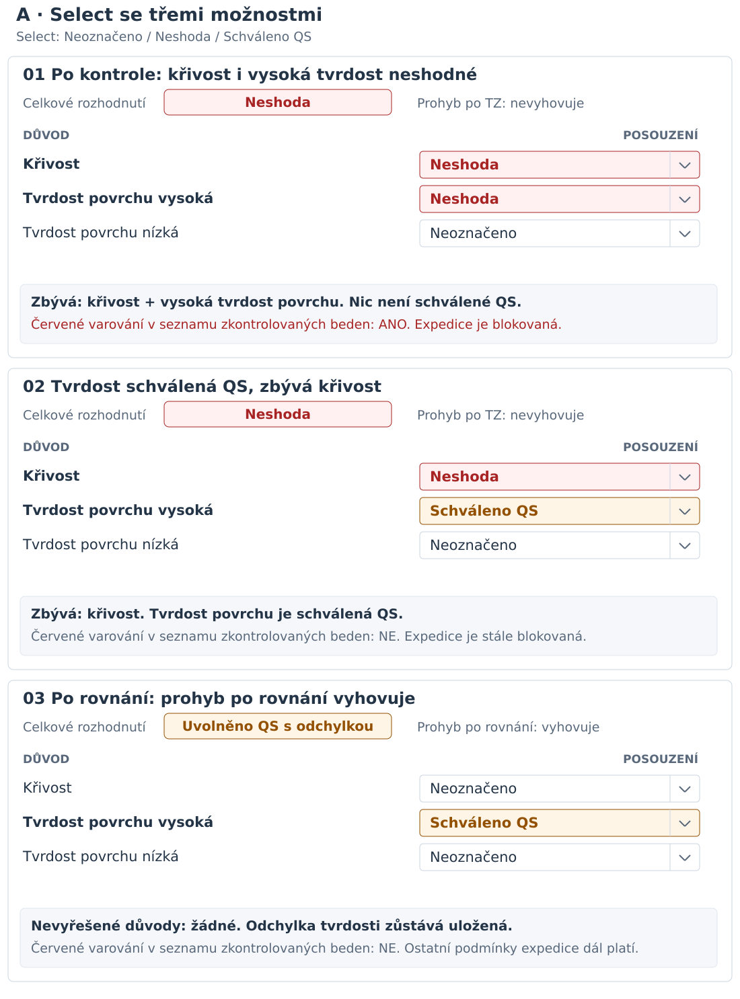
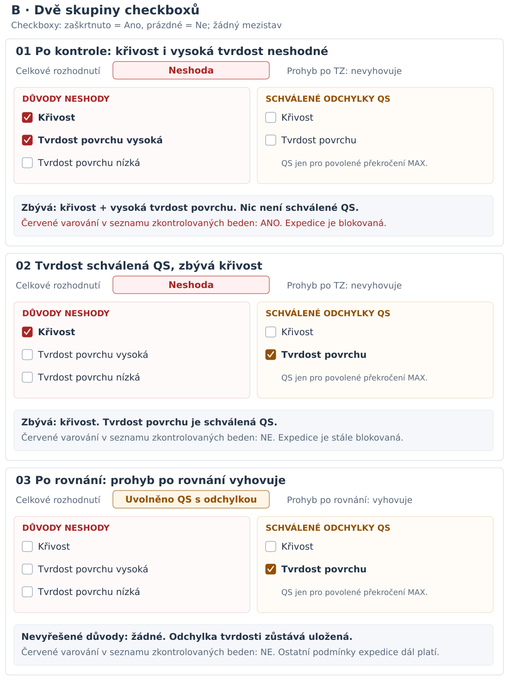
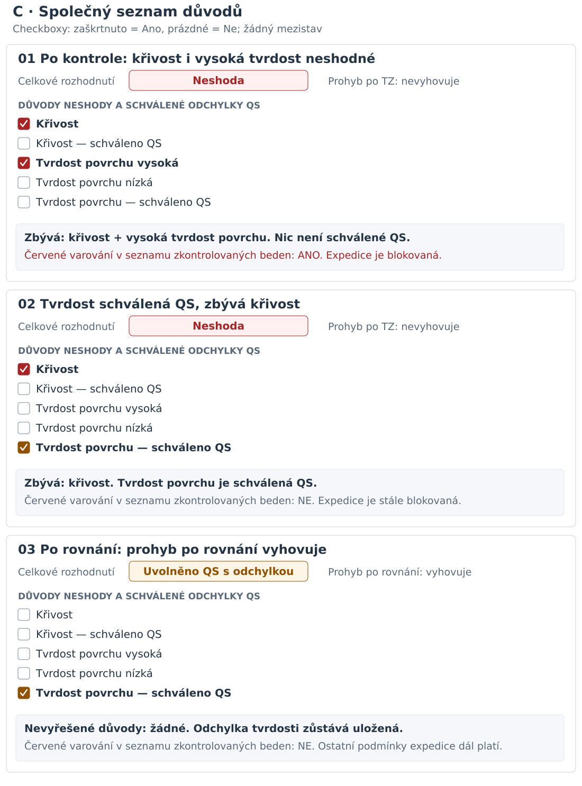

# Rozlišení neshod a schválených odchylek QS

Podklad k rozhodnutí postupu vyřešení problému neexistujícího rozlišení neshod a schválených odchylek QS při více vybraných důvodech neshody.

## 1. Problém a požadovaný výsledek

Současná kontrola má společné rozhodnutí pro celou bednu: Neshoda, Uvolněno nebo Uvolněno QS s odchylkou. Důvody jsou samostatné checkboxy bez vlastního posouzení. Stejný seznam se používá pro Neshodu i pro uvolnění QS.

Nelze proto zaznamenat, že jeden nález vyžaduje opravu a druhý už byl přijatý s odchylkou. Poznámka tuto informaci vysvětlí člověku, ale aplikace ji neumí použít pro zvýraznění, filtry nebo kontrolu dalšího postupu.

### Konkrétní případ

Bedna je křivá a má vysokou tvrdost povrchu. V běžném případě může být nejprve nutná výrobní oprava tvrdosti a až potom rovnání. V popsaném případě však kontrola vysokou tvrdost schválila QS; bedna může rovnou na rovnání.

| Oblast | Současný zápis | Potřebná informace |
| --- | --- | --- |
| Celkové rozhodnutí | Neshoda | Zůstává Neshoda, dokud není vyřešená křivost |
| Křivost | Zaškrtnuto | Nevyřešená neshoda, je potřeba rovnání |
| Tvrdost povrchu vysoká | Zaškrtnuto | Schváleno QS, kvůli tvrdosti se výrobní oprava nevyžaduje |
| Administrativa | Červené varování v seznamu zkontrolovaných beden kvůli dalšímu důvodu vedle křivosti | Nyní v přehledu neshod ručně dopsaná poznámka "Tvrdost jádra je Uvolněna na QS" |
| Po úspěšném vyrovnání | Bez poznámky není jasné, jak naložit s tvrdostí | Po potvrzení kontroly Uvolněno QS s odchylkou; důvod QS "Tvrdost povrchu vysoká" zůstává uložený |

Cílem je evidovat zvlášť **co brání uvolnění** a **co bylo schváleno s odchylkou**. Schválení jednoho nálezu neznamená uvolnění celé bedny.

Grafické náhledy níže porovnávají vždy stejné tři situace:

1. **Po kontrole jsou neshodné křivost i vysoká tvrdost povrchu:** Oba důvody jsou nevyřešené, žádná odchylka není schválená QS. Celkové rozhodnutí je Neshoda.
2. **Tvrdost povrchu je schválená QS:** Křivost zůstává neshodou. Celkové rozhodnutí zůstává Neshoda.
3. **Po rovnání a vyhovujícím prohybu po rovnání:** Křivost už není označená, schválená odchylka tvrdosti povrchu zůstává. Po potvrzení kontroly je celkové rozhodnutí Uvolněno QS s odchylkou.

Popisek **„Červené varování v seznamu zkontrolovaných beden“** označuje červené zvýraznění buňky **Stav bedny** a symbol **⚠** v administrativním seznamu při filtru **Stav bedny = Zkontrolováno**. V navrženém řešení znamená **ANO**, že zbývá nevyřešený důvod mimo samotnou křivost, například vysoká tvrdost povrchu. **NE** znamená, že se toto zvýraznění nezobrazuje; při samotné křivosti zůstává bedna v Neshodě a expedice je stále blokovaná. Samotnou křivost ukazuje stav Rovnání. Tento popisek tedy vyjadřuje zvýraznění v seznamu, nikoli celkové rozhodnutí o uvolnění bedny.

Jde o návrhy vzhledu, nikoli o již zavedenou funkci. Checkboxy mají pouze hodnoty **Ano (zaškrtnuto)** a **Ne (prázdné)**; žádný mezistav se nepoužívá. Dostupnost schválení QS se řídí měřením: QS neumožňuje podkročení minima a po rovnání se pro křivost neuplatňuje.

## 2. Varianta A: Select se třemi možnostmi u každého důvodu

Každý důvod se zobrazí jednou a má rozbalovací seznam (select) s volbami **Neoznačeno / Neshoda / Schváleno QS**. Neoznačeno znamená „důvod není označený“, nikoli „zkouška byla provedena a vyhověla“. U důvodů, které QS nepřipouštějí, se volba QS nenabízí nebo je nedostupná.

### Grafický náhled: obě neshody, schválení tvrdosti QS a stav po rovnání

### Pohled kontroly

**Výhody:** Důvod se hledá na jednom místě a má jeden kompaktní select, vhodný i pro užší obrazovku. Přechod z neshody do QS je změna jedné hodnoty. U téhož důvodu nelze současně zvolit Neshodu i QS. Řádky se dobře porovnávají a nabídku lze omezit podle měření.

**Nevýhody:** Oproti současným checkboxům je potřeba otevřít nabídku a vybrat hodnotu. Ostatní dostupné možnosti jsou vidět až po rozbalení selectu. Je potřeba dobře odlišit neoznačený důvod, vyhovující zkoušku a dosud neprovedené měření.

### Pohled kódu

**Výhody:** Při uložení jedné stavové hodnoty pro každý důvod je význam jednoznačný a nevzniká kombinace „Neshoda i QS“. Společná logika může pracovat s jedním katalogem důvodů, jejich stavy a povolením QS. Dobře se řeší změny stavů, filtry a historie.

**Nevýhody:** Nahrazení současných booleanů stavovými poli znamená širší změnu modelu, formuláře, JavaScriptu, dotazů i historie. Převod starých hodnot potřebuje pravidla a případnou datovou migraci. Stále je nutná kontrola, zda daný důvod a měření vůbec dovolují QS.

Třípolohové rozhraní lze také uložit do dvojice vzájemně výlučných booleanů. Pak se zmenší rozdíl vůči variantám B a C, ale databázová výhoda jediné stavové hodnoty se ztrácí.

## 3. Varianta B: Dvě skupiny checkboxů

Samostatně se zobrazí **Důvody neshody** a **Schválené odchylky QS**. Skupina QS obsahuje pouze podporované odchylky.

### Grafický náhled: obě neshody, schválení tvrdosti QS a stav po rovnání

### Pohled kontroly

**Výhody:** Zůstávají známé checkboxy. Na první pohled jsou oddělené problémy k řešení a přijaté odchylky. QS část může být kratší, protože neexistují QS důvody pro podkročení minima. Dvě skupiny odpovídají tomu, co potřebuje číst administrativa.

**Nevýhody:** Při schválení je potřeba přesunout důvod mezi skupinami. Bez pomoci formuláře může obsluha zapomenout původní neshodu odškrtnout. Na telefonu mohou být skupiny daleko od sebe. Při větším počtu podobných důvodů se hledá ve dvou místech.

### Pohled kódu

**Výhody:** Lze zachovat současná pole pro neshody a doplnit samostatná QS pole. Dotazy na blokující neshody a schválené odchylky jsou přímočaré. Přidání polí umožňuje postupné rozšíření, starší snapshoty mohou zůstat beze změn.

**Nevýhody:** Jsou potřeba pravidla vzájemného vyloučení, například „tvrdost povrchu vysoká“ a „tvrdost povrchu QS“ nesmějí být současně označené. Přibude více polí a vazeb mezi nimi. Všechny části pracující se současným seznamem důvodů je potřeba rozšířit: samotné přidání QS polí nevyřeší přehledy, expedici ani historii.

Rozhraní může při volbě QS automaticky odškrtnout odpovídající neshodu; uložení musí stejné pravidlo ověřovat na serveru. Podkročení minima musí schválení QS příslušné zkoušky nadále blokovat.

## 4. Varianta C: Společný seznam s položkami „schváleno QS“

V jednom seznamu budou běžné důvody i samostatné QS položky.

Označení „schváleno QS“ je vhodnější než „uvolněno QS“: celá bedna může kvůli jinému důvodu stále zůstávat v Neshodě.

### Grafický náhled: obě neshody, schválení tvrdosti QS a stav po rovnání

### Pohled kontroly

**Výhody:** Zachová se jeden známý seznam checkboxů. Vhodnou položku lze vybrat přímo bez přechodu do jiné sekce. U malého počtu QS položek je změna obsluhy malá. Související neshoda a QS mohou být hned vedle sebe.

**Nevýhody:** Seznam se prodlouží a podobné názvy zvyšují možnost omylu. Míchají se problémy k řešení a již přijaté odchylky. Pro rychlé posouzení je nutné číst dovětky; barva sama nestačí. Stejně jako u dvou skupin může vzniknout dvojí zaškrtnutí.

### Pohled kódu

**Výhody:** Může používat přesně stejná databázová pole a stejná validační pravidla jako varianta B. Rozdíl pak spočívá hlavně v sestavení formuláře. Současné booleany pro neshody lze zachovat a přidat jen potřebné QS položky.

**Nevýhody:** Každá položka musí mít výslovně určené, zda je blokující neshoda, nebo schválená odchylka, a ke které zkoušce patří. Pouhé přidání QS položek do dnešního seznamu důvodů by způsobilo chyby: obecné podmínky typu „je zaškrtnutý nějaký důvod mimo křivost“ by mohly dál vyvolávat červené varování i pro QS. Hrozí rozptýlení ručních seznamů a výjimek v různých částech aplikace.

Stejně jako u B je potřeba společný popis důvodů a jejich vazeb, serverové ověření vzájemného vyloučení a pravidla pro soulad s měřením.

## 5. Rychlé porovnání

Hodnocení předpokládá u A jednu stavovou hodnotu na důvod a u B/C samostatné booleany pro neshody a QS. Nejde o časový odhad implementace.

| Kritérium | A: Select se třemi možnostmi | B: Dvě skupiny | C: Společný seznam |
| --- | --- | --- | --- |
| Zvyk pro dnešní obsluhu | Výběr ze selectu místo checkboxu | Známé checkboxy, dvě části | Nejbližší dnešnímu seznamu |
| Přehlednost jednoho nálezu | Důvod jednou, stav vedle něj | Důvod se přesouvá mezi skupinami | Související položky mohou být vedle sebe |
| Oddělení práce k řešení a QS | Vyžaduje čtení zvolených stavů | Nejpřímější oddělení | Smíchané v jednom seznamu |
| Riziko současné Neshody i QS pro stejný nález | Odstraněné jednou stavovou volbou | Nutná validace dvojic | Nutná validace dvojic |
| Rozsah formuláře | Jeden kompaktní select na řádku | Dvě skupiny, QS může být krátká | Delší seznam podobných položek |
| Návaznost na dnešní booleany | Větší změna při přechodu na stavová pole | Dobrá | Dobrá |
| Dlouhodobá jednoznačnost dat | Nejlepší s jedním stavem | Závisí na omezeních kombinací | Stejná jako B při stejných polích |

Jedna databázová struktura může podporovat více rozhraní. Volba formuláře tedy nemusí definitivně určit způsob uložení. Zejména B a C mohou sdílet celý datový základ; rozdíl mezi nimi lze případně ověřit ukázkou formuláře s kontrolory.

## 6. Rozhodovací vodítko pro jednání

- **A zvolit**, pokud je prioritou jeden jednoznačný stav každého důvodu, snadné přepínání a ochota přijmout změnu ovládání i širší převod současného modelu.
- **B zvolit**, pokud je prioritou jasně oddělit práci k řešení od schválených odchylek a zachovat známé checkboxy. Je to rozumný kompromis pro současnou aplikaci.
- **C zvolit**, pokud je prioritou co nejpodobnější obsluha dnešnímu seznamu a QS položek zůstane málo. Je potřeba přijmout delší seznam podobných názvů.
